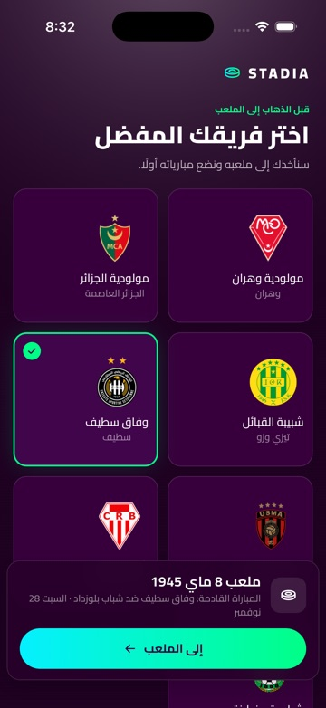
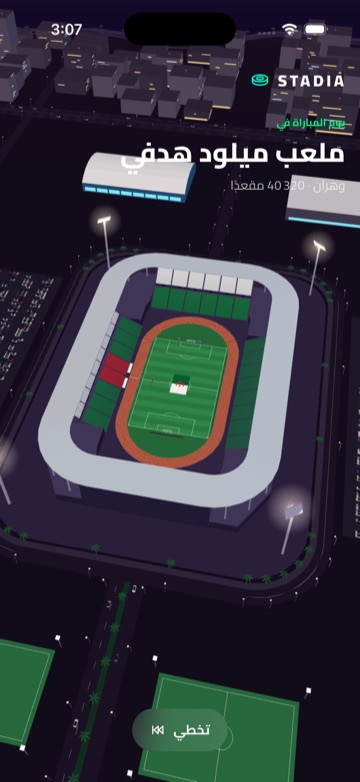
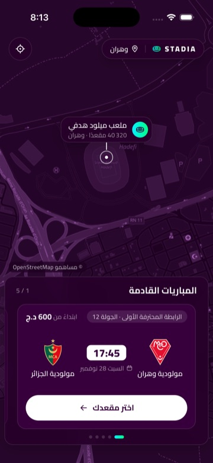
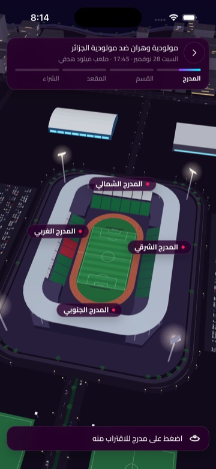
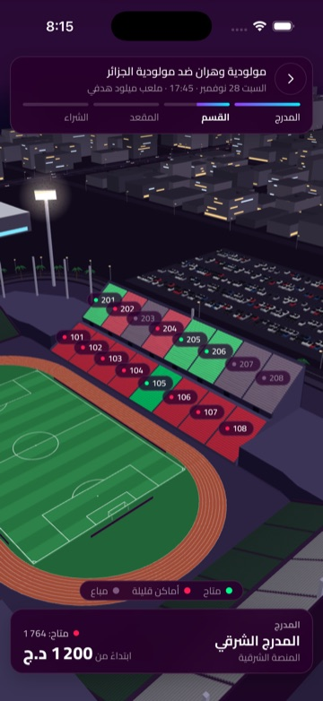
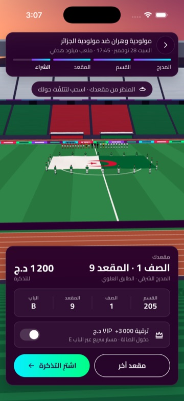
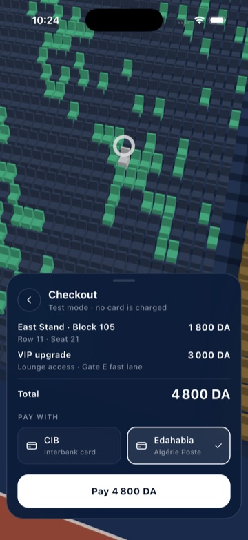
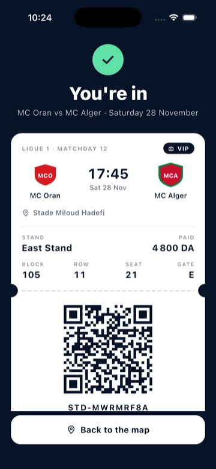

# Stadia

Stadium ticket booking for iOS, Android and the web with a 3D seat picker.
You find the match on a map, pick your stand, block and seat on an
interactive 3D model of the stadium, sit in that seat (the live 3D view from
it, full screen), pay, and get a ticket with an entry QR code.

The app is in Arabic (Algeria) with English as a second locale, set in Cairo,
and its design system follows the Fantasy Premier League site: the purple
ramp, the green/cyan/lilac accents and gradients, pill buttons, 8/12/16 px
radii and its card shadow.

There are two demo stadiums, each with its own 3D model: Stade Miloud
Hadefi in Oran (~40,000 seats, two tiers, by the sea) and the 8 May 1945
Stadium in Sétif (~25,000 seats, one tier, in the highlands). Both have Ligue 1
and Algerian Cup fixtures between Algerian clubs. On first launch you pick
your favourite club, and the app takes you to its stadium. All data is
mocked behind repository and payment interfaces (see
[Going to production](#going-to-production)).

| Pick your team | Intro | Map | Stand |
|---|---|---|---|
|  |  |  |  |

| Block | View from the seat | Checkout | Ticket |
|---|---|---|---|
|  |  |  |  |

## The flow

1. **Splash**: "Loading the stadium" while the 3D assets server starts.
2. **Pick your team** (first launch only): a grid of the seven clubs. The
   choice is saved on the device and decides the stadium: the club's home
   ground, or the ground of its next match. A panel shows that stadium and
   the club's next match there. Change it later from the crest on the map.
3. **3D intro**: an orbit around the floodlit stadium, with Skip.
4. **Map**: OpenStreetMap (purple-tinted tiles, attribution shown) centred on
   the stadium, with the gates and a glass "Upcoming matches" card that opens
   on your club's next match (its matches have a green outline). Tap the
   city to switch stadium, or the crest to change your team.
5. **3D seat picker**: Stand → Block → Seat → Buy. Each tap flies the camera
   in. Blocks and seats are coloured by availability (free / few left /
   sold). A floating glass card shows the selection, free seats and price.
6. **In the seat**: the camera flies into the chosen seat and stays there:
   the live, full-screen view from a seated fan's eye height, drag to look
   around (no pop-up, no snapshot). A panel in the same screen shows block /
   row / seat / gate / price, the VIP upgrade (+3 000 DA, lounge, Gate E),
   "Another seat" and "Buy ticket".
7. **Checkout**: order lines, CIB or Edahabia, Pay (mock).
8. **"You're in"**: a notched ticket with the match, seat, gate, entry QR and
   the gates-open time.

## Quick start

Requirements: Flutter 3.44 (Dart 3.12), Xcode with an iOS simulator and/or
Android Studio with an emulator. Node and Blender are only needed to rebuild
the 3D viewer or the model. Both are already built and committed under
`assets/`.

```bash
flutter pub get
```

```bash
flutter run
```

Pick a device with `-d`, e.g. `flutter run -d "iPhone 17 Pro"` or
`flutter run -d emulator-5554`.

### Web

```bash
flutter run -d chrome
```

Release build, static files in `build/web` for any static host:

```bash
flutter build web --release
```

Serve it locally and open `http://localhost:8790`:

```bash
python3 -m http.server 8790 --directory build/web
```

Served from a sub-path, build with `--base-href /stadia/`. The app uses hash
URLs (`/#/map`), so the host needs no rewrite rules. In a wide window it runs
in a phone-width column; at phone width it fills the screen, as the app does.

### Debugging the 3D view

Show the 3D overlay (fps, draw calls) and stream `stats` messages:

```bash
flutter run --dart-define=STADIA_3D_DEBUG=true
```

Checks:

```bash
flutter analyze
```

```bash
flutter test
```

The tests cover:

- the booking state machine (unit tests);
- the seat picker driven by injected 3D events;
- the seat panel → checkout → ticket flow, end to end (and back from
  checkout to the seat);
- Arabic: data resolution, ar_DZ formatting, RTL layout, crest assets;
- the ticket screen;
- the checkout service (charge, VIP, declined, cancelled, seat taken before
  paying);
- the loopback asset server, the intro screen and the map screen;
- the phone-width column for wide browser windows;
- the mock repository.

## Regenerating the 3D model

Each stadium has one config, `assets/data/stadiums/<id>.json`. It is the
single source of truth for the layout: stands, tiers, blocks, rows, seats per
row, gates and prices. An optional `model` section sets the look: roof,
corners, seat colours, the home kit and the surroundings. The Blender script
builds the whole bowl from the config. Because of that, mesh names
(`Block_E_105`) always match the app's ids (`E_105`).

```bash
blender -b --factory-startup -P tools/blender/build_stadium.py -- --config assets/data/stadiums/miloud-hadefi.json --out assets/3d/miloud-hadefi.glb
```

```bash
blender -b --factory-startup -P tools/blender/build_stadium.py -- --config assets/data/stadiums/8-mai-1945.json --out assets/3d/8-mai-1945.glb
```

Options after `--`: `--no-draco` (bigger, easier to inspect),
`--no-env` (the stadium alone, without its surroundings) and
`--blend out.blend` (also save the scene). Install Blender with
`brew install --cask blender` on macOS. The script was written against
Blender 4.5 LTS. A run takes about a minute.

For Oran it produces (Draco-compressed, about 940 KB and 135k triangles,
budget 5 MB):

- pitch and markings, athletics track;
- 4 two-tier stands with 56 blocks and merged seat rows;
- red VIP seating in the West Stand, roof ring, floodlights and concourse;
- matchday details (`Ceremony_*`, `Boards_LED`, `Goal_Nets`, `Dugouts`,
  `Fascia_LED_*`): both teams and the referees lined up for the anthems in
  front of the main stand, a giant Algerian flag held over the centre circle
  by flag bearers, lit LED advertising boards, a lit ribbon under the upper
  tier, goal nets and team dugouts;
- the surroundings at night (`Env_*` meshes, from a fixed seed so every run
  is the same): a stylised Bir El Djir with the sea and a coastal highway to
  the north, a ridge to the west, the ring road, palm-lined plaza and car
  parks round the stadium, a boulevard and roundabout to the south, an
  aquatic centre, a sports hall and two lit training pitches, then about
  1,150 city blocks with lit windows, street lights and cars out to 1.6 km.

For Sétif (about 965 KB) it builds a single-tier bowl of 23 blocks, 36 rows
deep, with curved terraces filling the corners. The seats are striped in
ES Sétif's black and white, with gold VIP seats under a cantilevered canopy
over the West Stand only. The players line up in ES Sétif's kit, with the
referees in teal. The city around it is set in the highlands, with no sea:
pines instead of palms, a mosque with a green dome and a lit minaret in place
of the aquatic centre, and snow-capped ridges to the north.

Kick-off is at dusk. The bake warms every face that looks towards the
setting sun (west-south-west, 20° up) and cools the faces turned away. The
viewer draws the matching sky itself (`tools/web/src/sky.js`): a sunset
gradient, the sun with a lens flare that hides behind the stands, the first
stars and the moon rising in the east. The fog turns into a warm haze
towards the sun, so the far city fades into the sunset on that side. The
sun direction is defined twice, as `SUNSET` in the generator and `SUN_DIR`
in `sky.js`, and the two must match. The surroundings are not pickable and never move the camera
framing, which uses the stands and roof only.

Lighting is baked into vertex colours, so the viewer needs no lights or
shadows. Selectable meshes are named `Stand_<S>`, `Block_<S>_<nnn>` and
`Seats_<S>_<nnn>`, with seat-grid metadata in the node extras. The header of
`build_stadium.py` documents the axes and naming.

## Rebuilding the 3D viewer

The viewer is plain Three.js (r0.187), bundled offline into
`assets/web/stadium.js`. The Draco decoder is copied to `assets/web/draco/`.
The bundle targets Chrome 74 (the WebView Android 10 ships with) and Safari
15. `src/compat.js` fills the two runtime APIs three needs that old WebViews
lack (`WeakRef`, `FinalizationRegistry`).

```bash
cd tools/web && npm ci && npm run build
```

To work on it in a desktop browser without Flutter:

```bash
cd tools/web && npm run serve
```

Then open `http://localhost:5175/index.html?mode=picker&debug`. With
`debug` and no Flutter host, a dev harness plays the app's side: it sends
availability and steps and answers taps. Esc goes back,
I simulates the tall checkout panel. `mode=intro` plays
the intro; `&spin` auto-rotates and renders every frame (for fps checks).

## Regenerating the app icons

The icons are drawn from the app's stadium glyph, as SVGs in `tools/icons/`:

- `icon.svg`: the full-bleed icon. It gives the iOS set (opaque, iOS rounds
  the corners), the web maskable icons, and the rounded legacy Android and
  web icons.
- `adaptive.svg`: the Android adaptive icon layers: background, foreground
  and monochrome (Android 13 themed icons). The glyph stays inside the
  66 dp safe circle.
- `favicon.svg`: a bolder glyph for 16 to 32 px.

Needs Inkscape 1.x and ImageMagick 7:

```bash
bash tools/icons/build_icons.sh
```

Inkscape renders each SVG once at full size and ImageMagick scales it to
every size in the iOS asset catalog, the five Android densities and the web
manifest.

## Architecture

```text
lib/
  app/            MaterialApp.router, go_router routes (fade transitions)
  l10n/           ARB files (ar, en) + generated AppLocalizations
  ui/             design system: FPL-style tokens, Cairo text styles, glass
                  surface, pill buttons, hand-drawn glyphs (no icon packs),
                  loaders, team crests, ar_DZ / en number and date formats,
                  phone-width column for wide browser windows
  data/
    models/       Stadium, Stand, Block, SeatRef, FootballMatch, Ticket, ...
    repositories/ StadiumRepository (interface) + LocalStadiumRepository (JSON)
    payment/      PaymentService (interface) + Mock + Chargily slot
    favourite_team.dart  saved favourite club + where it takes you (TeamPlan)
    providers.dart Riverpod wiring (swap implementations here)
  features/
    splash/       boot tasks (data + 3D server on iOS/Android), then team
                  picker or intro
    team/         favourite-team picker
    stadium3d/    loopback asset server + WebView (iOS/Android), iframe
                  (web), scene controller, protocol, intro screen
    map/          flutter_map + OSM, gates, stadium marker, stadium switcher
    matches/      upcoming matches card
    seat_picker/  BookingMachine (pure), BookingController, picker screen,
                  seat panel (buy step, in the picker's tree)
    ticket/       Checkout service, ticket screen, notched ticket card
tools/
  blender/        build_stadium.py (headless model generator)
  icons/          app icon SVGs + build_icons.sh (iOS, Android, web)
  web/            Three.js viewer sources + esbuild bundling + dev server
web/              Flutter web shell: index.html, manifest, icons
assets/
  data/           stadiums/<id>.json, matches.json
  3d/             <id>.glb (one model per stadium)
  web/            index.html, stadium.js, draco/
```

**State.** Riverpod 3:

- `bookingContextProvider(matchId)` loads stadium, match and availability
  together.
- `bookingControllerProvider(matchId)` holds the selection and feeds every
  event through `BookingMachine.reduce`. The machine is a pure, synchronous
  state machine; invalid taps return the same state with a notice and never
  throw.
- `ticketWalletProvider` keeps the issued tickets.

**3D, in a WebView.** At startup a `dart:io` HTTP server on `127.0.0.1`
(random port) serves `assets/web` and `assets/3d` from the Flutter asset
bundle. `webview_flutter` loads `http://127.0.0.1:<port>/index.html`. Why not
`file://`: Android WebView blocks fetch and WASM from file URLs, and the
Draco decoder runs in a Worker that needs a real origin. Restrictions:

- the server answers GET/HEAD only;
- it maps paths into those two asset folders only and rejects `..`;
- it refuses foreign Host headers;
- the WebView cannot navigate off the loopback origin.

Cleartext HTTP is allowed only for 127.0.0.1/localhost: Android
`network_security_config.xml`, iOS `NSAllowsLocalNetworking`.

**3D on the web.** The web build has no WebView and no `dart:io`. A
conditional import in `stadium_view.dart` picks `stadium_platform_web.dart`,
so neither reaches the web compiler. The app's own origin already serves
`assets/web` and `assets/3d`, so there is no server to start:

- the same viewer page runs in a same-origin `<iframe>`
  (`stadium_frame_view.dart`) and finds the models at `../3d/`
  (`?models=../3d`);
- `index.html` defines `StadiaBridge` only when it is framed without a native
  channel; the page posts `{stadiaBridge: json}` to its parent and Flutter
  posts `{stadia: json}` back, and both sides drop messages from any other
  window or origin;
- the iframe sits above Flutter's pointer handling, so the cards and buttons
  drawn over the scene are wrapped in `OverScene`, which puts an invisible
  DOM element under them (as `pointer_interceptor` does). Notes that should
  let drags through, like the seat-view hint, stay unwrapped.

**Rendering budget.** All of these target 60 fps on mid-range Android:

- unlit `MeshBasicMaterial` with baked vertex colours;
- no shadows and no post-processing;
- pixel ratio ≤ 2;
- static geometry merged into a few draw calls;
- individual seats only for the block being picked (one `InstancedMesh`);
- frames rendered only when something changed.

**Camera.** Each step has a framed view: overview, stand, block, seat. The
Flutter UI reports how much of the screen its cards cover (`insets`). The
scene shifts the projection centre and fits the target into the visible gap,
so the seat always sits between the top card and the bottom sheet.

### Bridge protocol

Flutter → JS: `window.stadia.receive(json)`. JS → Flutter: the
`StadiaBridge` JavaScript channel. Messages sent before the page reports
`ready` are queued, and only the latest of each kind is kept.

| Direction | Message | Meaning |
|---|---|---|
| → JS | `init {mode}` | `intro` or `picker` |
| → JS | `setStep {step, stand?, block?, seat?}` | current booking step; the camera flies there (`buy`: into the seat, first person) |
| → JS | `availability {level: stand\|block, items}` | free ratio 0..1 per stand/block |
| → JS | `availability {level: seat, block, rows, seats, sold[]}` | sold seat indexes (row-major) |
| → JS | `labels {items}` | stand names for in-scene labels |
| → JS | `insets {top, bottom}` | screen px covered by Flutter UI |
| → JS | `highlight {id}`, `skipIntro` | |
| → Flutter | `ready {timings}` | scene loaded |
| → Flutter | `select {level, id}` | a stand / block / seat was tapped |
| → Flutter | `introDone`, `error {message}`, `stats {fps, calls, triangles}` | |

The source of truth is the doc comment in
`lib/features/stadium3d/stadium_protocol.dart`.

## Going to production

### Mocked vs production

| Area | Now (mock) | Production needs |
|---|---|---|
| Stadium, matches | Bundled JSON via `LocalStadiumRepository` | `SupabaseStadiumRepository` implementing `StadiumRepository` (schema below) |
| Availability | Generated once per match from a demand factor, kept in memory | Live sold/held seats from the backend, realtime updates (Supabase Realtime on `tickets`) |
| Seat locking | Re-check right before paying; no hold | Server-side hold with a TTL (`hold_seat` RPC) before redirecting to payment, released on failure/expiry; one live ticket per seat enforced by a unique index |
| Payment | `MockPaymentService` always succeeds after 1.4 s | `ChargilyPaymentService`: backend creates the Chargily Pay checkout (CIB/Edahabia), app opens `checkout_url`, backend webhook verifies the `signature` HMAC and issues the ticket. The secret key lives only on the backend |
| Refunds | Message only ("will be refunded") | Refund flow through Chargily and backend order states |
| Ticket issuing | `issueTicket` on the device | Issued by the backend after the webhook, never by the app |
| QR code | Plain `STADIA:1:<ticket>:<match>:<seat>:<gate>` | Server-signed payload (e.g. Ed25519 with key id and expiry); gate scanners verify offline with the public key and record scans for single entry |
| Favourite team | Saved on the device (`shared_preferences`) | Stored on the user's profile so it follows the account; fixtures and offers for that club |
| Wallet | In memory, lost on restart | Persisted per account, available offline (encrypted local cache) |
| Accounts | None | Supabase Auth (phone/OTP is common in Algeria); RLS so users only read their own tickets |
| Map tiles | `tile.openstreetmap.org`, tinted on device | The OSM tile usage policy does not allow app-scale traffic: use a tile provider with a key (MapTiler, Mapbox, …) or self-hosted dark vector tiles; keep the attribution |
| View from the seat | Live first-person view of the procedural model | A surveyed model; optionally 360° captures per block |
| Team crests | Real club crests bundled for the demo (club trademarks), drawn shield as fallback | Written permission from each club (or the LFP), served from the CDN by `team.logo` |
| Stadium model | Procedural, approximate | A surveyed model of the real ground (same naming convention, same script output contract) |
| Surroundings | Stylised Bir El Djir (Oran) and highland Sétif from fixed seeds (not the real streets) | Real footprints and heights from OSM (ODbL, attributed) or a city model, cut to a few km and baked the same way |
| Localisation | Arabic (Algeria, default) and English; data names as `{en, ar}` maps | French; native-speaker review; server-side names per `Accept-Language` |
| Ops | None | Crash reporting, analytics, remote config for prices and gates opening time |

### Supabase sketch

```sql
create table stadiums (
  id text primary key, name text, city text,
  lat double precision, lng double precision,
  vip_upgrade_price int, gates_open_minutes_before int,
  layout jsonb                 -- the stands/blocks section of stadiums/<id>.json
);

create table matches (
  id text primary key, stadium_id text references stadiums,
  home_team text, away_team text, kickoff timestamptz,
  competition text, round text, price_multiplier numeric
);

create table tickets (
  id text primary key,
  match_id text references matches, seat_id text,   -- 'E_105_R11_S21'
  user_id uuid references auth.users,
  vip boolean default false, amount int,
  status text check (status in ('held', 'paid', 'cancelled', 'refunded')),
  hold_expires_at timestamptz, payment_ref text,
  created_at timestamptz default now()
);
-- One live ticket per seat and match.
create unique index one_live_ticket on tickets (match_id, seat_id)
  where status in ('held', 'paid');
```

Availability is a view or RPC that returns, per block, the row-major indexes
of held and paid seats. That matches the `availability {level: seat}`
message, so the 3D side doesn't change.

## Credits and licences

- **Cairo** font by Mohamed Gaber and Accademia di Belle Arti di Urbino,
  [SIL Open Font License 1.1](assets/fonts/OFL.txt). Static weights were
  cut from the variable font; the 3D labels use the same files.
- **Club crests** (MCO, MCA, JSK, ESS, USMA, CRB, CSC) are the clubs'
  trademarks, included only to demo the UI. Get permission before any
  release.
- **Design**: the colours, radii and component shapes are modelled on the
  Fantasy Premier League website. Stadia is not affiliated with the Premier
  League; the FPL typefaces are not used.
- **Map data** © OpenStreetMap contributors (ODbL).
